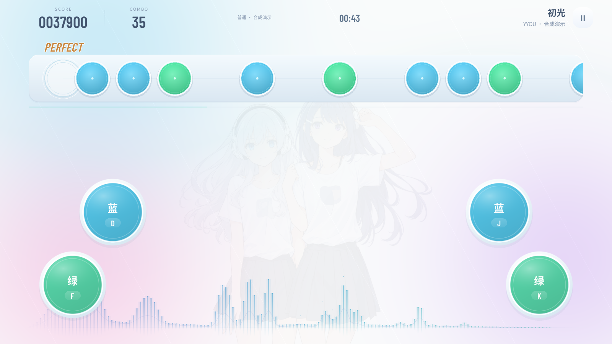

# YYOU

一个使用 Unity 开发的横向节奏游戏原型。音符从右侧接近判定点，用蓝、绿两种输入演奏，包含双手大音符与连续敲击。

项目停止商业开发后，以可运行的原型形式开放源码。这里保留玩法、界面与工程实现，供学习、修改和继续开发；不承诺后续内容更新。

**[下载 Windows / Android 试玩包](https://github.com/QTGB/YYOU/releases/tag/v0.3.0)** · [构建说明](Docs/BUILD.md) · [歌曲与谱面](Docs/CONTENT.md) · [许可说明](THIRD_PARTY_NOTICES.md)

## 公开版包含什么

- 开始、选曲、难度选择、演奏、暂停、结算和设置页面。
- 蓝绿单击、同色双手大音符、蓝色连打；DSP 时钟与统一输入判定。
- 五档难度，独立速度、节奏校准与手动偏移。
- 可改键位，三种触摸按键布局，横屏安全区处理。
- 音乐、敲击和 MISS 三路音量；随音乐变化的底部频谱。
- 按歌曲、难度和谱面修订号隔离的本地成绩。
- 四个曲包的滑动浏览、试听和模拟购买。**显示的人民币价格仅用于交互演示，没有付款、扣款或联网交易。**
- 13 段原创合成演示音乐、65 张示例谱面；《初光》免费直接演奏，其余按 4 × 3 首组织，用来验证商店流程。

### 与内部原型的区别

公开仓库和安装包**不含内部原型中下载的商业歌曲、歌曲封面和第三方谱面**。演示音频由仓库内脚本直接合成，没有使用外部录音或采样。四种分类只是展示原有筛选、曲包与获取流程，不代表合成示例有人声或来自某部动画。敲击音效也使用独立合成版本。

UI 中的 MiSans 已替换成允许随源码分发的 Noto Sans CJK SC，保留 Barlow Condensed。字体许可单独列在 `Licenses/`。看板人物为项目已有的 AI 辅助生成立绘；当前是静态图，没有完整 Spine 动作系统。

## 试玩

**Windows 64 位**：下载并完整解压 `YYOU-0.3.0-Windows-x64.zip`，运行其中的 `YYOU.exe`；不要只取出 EXE。

**Android**：安装 `YYOU-0.3.0-Android.apk`。支持 ARM64 / ARMv7、Android 6.0 及以上，横屏操作。APK 为直接安装的原型测试包，使用测试签名；没有上架商店，也没有实机兼容性保证。

首次进入演奏会显示可跳过的操作说明。默认键位：

| 操作 | 左手 | 右手 |
| --- | --- | --- |
| 蓝色 | D | J |
| 绿色 | F | K |

大音符需要同色左右两个输入；长条需要持续重复敲击蓝色输入，按住不算连打。`Esc` 暂停/恢复，具体键位可在设置中修改。

## 打开源码

1. 安装 Unity **2022.3.62f3c1**。这是实际构建使用的编辑器版本；其他 2022.3 LTS 补丁版本需要自行验证。
2. 在 Unity Hub 中添加本仓库根目录，等待导入完成。
3. 打开 `Assets/GameMain/Scenes/Start.unity` 并进入 Play。
4. 发布包可以通过菜单 `YYOU → Build Windows x64 / Build Android APK` 构建，详见 [BUILD.md](Docs/BUILD.md)。

无需下载内部曲库、Git LFS、付费 Unity 插件或联网服务。首次导入仍需 Unity Package Manager 获取项目声明的官方模块。

## 工程入口

| 路径 | 内容 |
| --- | --- |
| `Assets/GameMain/Scripts/DrumPractice` | 当前横向玩法、判定、时钟与反馈 |
| `Assets/GameMain/Scripts/Settings` | 音量、键位、校准与布局 |
| `Assets/GameMain/Scripts/SongSelection` | 曲库、选择与试听 |
| `Assets/GameMain/Scripts/SongPacks` | 曲包交互与本地模拟获取 |
| `Assets/GameMain/Scripts/StartScreen` | 开始界面、基础 UI 绘制与安全区 |
| `Assets/GameMain/Prefabs/UI` | 当前页面预制体 |
| `Assets/GameMain/Resources/DrumCharts` | 分曲目、难度存储的谱面 |
| `Assets/StreamingAssets/DemoMusic` | 可分发的合成音乐 |
| `Tools/generate_demo.py` | 示例音乐、音效和五档谱面的生成源码 |
| `Assets/Editor/PublicReleaseBuild.cs` | 构建和示例曲库配置 |

`RhythmPractice` 下保留了早期四轨玩法代码，主入口使用 `DrumPractice`。没有一并发布会覆盖现有界面的历史 UI Builder，也不包含内部备份、日志、预算和立项资料。

## 完成程度

这是原型存档，尚无真实支付、账号、联网、反作弊、云存档或正式运营系统。示例谱面用于验证程序，不是经过专业制谱与玩家听审的商业曲目。具体发布检查结果见 [VALIDATION.md](Docs/VALIDATION.md)。

源代码、原有项目界面素材及本次原创示例内容按 [MIT](LICENSE) 发布；第三方字体继续适用各自 OFL 许可，Unity Editor 与 Unity Runtime 不受本仓库 MIT 许可覆盖。请不要把自行导入的歌曲或第三方谱面自动视为可再分发内容。
